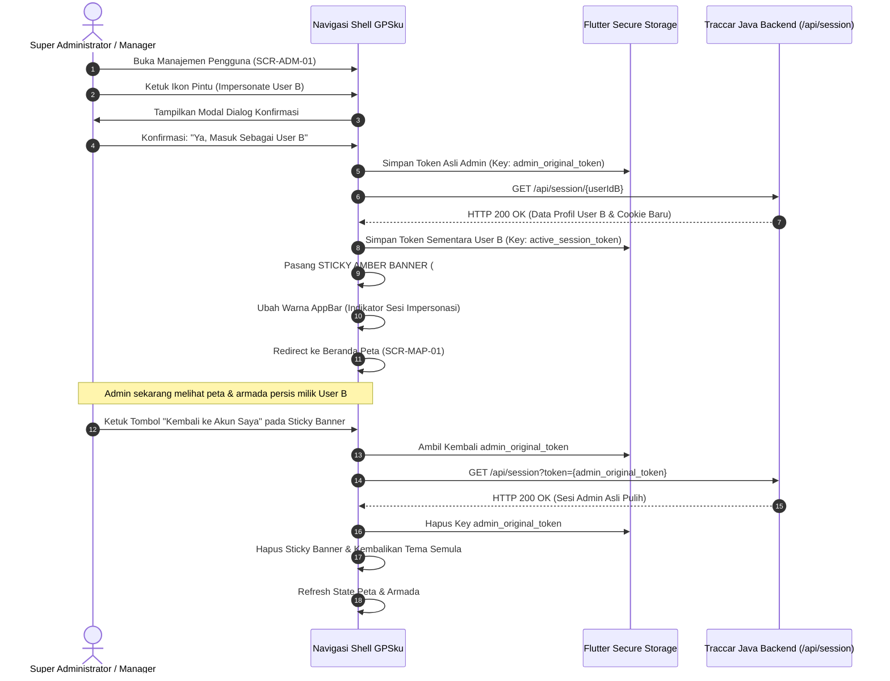

# INFORMATION_ARCHITECTURE.md — Arsitektur Informasi & Navigasi (GPSku)
## Phase 5 Deliverable — UI/UX Redesign & Information Architecture

* **Versi Dokumen:** 1.0.0  
* **Tanggal:** 2026-11-07  
* **Status:** Ready for Review (Phase 5)  
* **Sistem Target:** GPSku — Flutter Multi-Platform (Android & iOS Primary MVP, Web Secondary)  
* **Referensi Sumber:** `docs/01-existing-system/EXISTING_APP_ANALYSIS.md`, `docs/02-product/PRD.md` v2.1.0, & `docs/03-design/SCREEN_INVENTORY.md`

---

## 1. Struktur Navigasi Utama & Keputusan Arsitektur

### 1.1 Keputusan Pola Navigasi: Bottom Navigation Bar + Bottom Sheets
Pada aplikasi web desktop React lama (`traccar-web`), navigasi menggunakan kombinasi AppBar atas, Toolbar filter, dan dialog modal melayang. Pada perombakan antarmuka Flutter untuk perangkat layar sentuh mobile, diterapkan pola navigasi:

1. **Primary Navigation Shell: 5 Tab Bottom Navigation Bar**  
   Untuk akses ibu jari satu tangan (*one-handed thumb zone*), navigasi utama dibagi ke dalam 5 pilar fungsional:
   * **Tab 1: Peta (Live Tracking)** (`/tracking`) — Tampilan peta MapLibre GL real-time, status card mengambang, dan toolbar pencarian cepat.
   * **Tab 2: Armada (Devices)** (`/devices`) — Daftar master kendaraan dengan filter status, pencarian plat nomor, dan aksi CRUD.
   * **Tab 3: Laporan (Reports)** (`/reports`) — Hub modul pelaporan (Trips, Stops, Summary, Events, Positions Excel, Charts).
   * **Tab 4: Peringatan (Events)** (`/events`) — Riwayat kronologis alarm dan feed notifikasi insiden masuk.
   * **Tab 5: Pengaturan (Settings)** (`/settings`) — Pengaturan profil, preferensi, aturan notifikasi, administrasi server, dan logout.

2. **Contextual Action: Draggable Bottom Sheets (Bukan Layar Penuh Terpisah)**  
   * Detail kendaraan (`StatusCard`) menggunakan `DraggableScrollableSheet` yang menumpuk di atas peta. Pengguna tetap dapat melihat pergerakan kendaraan di peta saat menginspeksi sensor telemetri.
   * Filter lanjutan armada dan geocoder pencarian alamat menggunakan Modal Bottom Sheet.

3. **Persistent Impersonation Banner (Top-Pinned)**  
   * Banner mengambang warna oranye/amber (`#FF9800`) dipasang di atas AppBar pada seluruh tab saat sesi *User Impersonation* aktif.

---

## 2. Diagram Pohon Navigasi Global (Global Navigation Hierarchy)

```mermaid
graph TD
    AppStart["Cold Start Aplikasi"] --> AuthCheck{"Validasi Token Tersimpan?"}
    
    %% Alur Publik
    AuthCheck -- "Tidak Valid / Kosong" --> LoginNav["Shell Autentikasi"]
    LoginNav --> Login["SCR-AUTH-01: Login Email/SSO"]
    Login --> TOTP["SCR-AUTH-02: Verifikasi TOTP 2FA"]
    Login --> ResetPass["SCR-AUTH-03: Reset Password Email"]
    Login --> ServerConfig["SCR-AUTH-04: Host Server Config"]
    
    %% Alur Terproteksi
    AuthCheck -- "Token Valid (Bearer)" --> MainShell["MainShell (StatefulShellRoute 5 Tab)"]
    TOTP -- "Sukses" --> MainShell
    Login -- "Sukses (Tanpa 2FA)" --> MainShell
    
    %% 5 Tab Utama
    MainShell --> Tab1["Tab 1: Peta (Live Tracking)"]
    MainShell --> Tab2["Tab 2: Armada (Fleet Devices)"]
    MainShell --> Tab3["Tab 3: Laporan (Reports Hub)"]
    MainShell --> Tab4["Tab 4: Peringatan (Events Inbox)"]
    MainShell --> Tab5["Tab 5: Pengaturan (Settings Hub)"]
    
    %% Detail Tab 1
    Tab1 --> MapView["SCR-MAP-01: Viewport Peta Real-time"]
    MapView -.-> StatusCard["SCR-MAP-02: StatusCard Sheet"]
    MapView -.-> FilterSheet["SCR-MAP-03: Filter Armada Sheet"]
    MapView -.-> Geocoder["SCR-MAP-04: Geocoder Search"]
    StatusCard --> Replay["SCR-REP-01: Replay Rute Player"]
    StatusCard --> Command["SCR-CMD-01: Remote Cut-Off Modal"]
    StatusCard --> ShareLink["SCR-SPEC-02: Share Link Modal"]
    StatusCard --> Dashcam["SCR-MEDIA-01: Live HLS Video"]
    
    %% Detail Tab 2
    Tab2 --> DeviceList["SCR-FLT-01: Master List Armada"]
    DeviceList --> DeviceForm["SCR-FLT-02: Tambah/Edit Kendaraan"]
    DeviceList --> Accumulators["SCR-FLT-03: Kalibrasi Odometer"]
    DeviceList --> GroupMgmt["SCR-FLT-04: Grup & Hierarki"]
    
    %% Detail Tab 3
    Tab3 --> ReportsHub["SCR-RPT-01: Menu Pusat Laporan"]
    ReportsHub --> RepTrips["SCR-RPT-02: Laporan Perjalanan"]
    ReportsHub --> RepStops["SCR-RPT-03: Laporan Parkir"]
    ReportsHub --> RepSummary["SCR-RPT-04: Ringkasan Armada"]
    ReportsHub --> RepEvents["SCR-RPT-05: Riwayat Alarm"]
    ReportsHub --> RepRoute["SCR-RPT-06: Log Titik & Excel"]
    ReportsHub --> RepGeofence["SCR-RPT-07: Kunjungan Geofence"]
    ReportsHub --> RepChart["SCR-RPT-08: Grafik Telemetri"]
    ReportsHub --> RepSched["SCR-RPT-09: Laporan Terjadwal"]
    
    %% Detail Tab 4
    Tab4 --> EventList["SCR-NOTIF-03: Riwayat Insiden Masuk"]
    EventList -.-> FocusMap["Sorot Lokasi di Peta"]
    
    %% Detail Tab 5
    Tab5 --> SettingsList["SCR-SETT-01: Menu Pusat Pengaturan"]
    SettingsList --> Geofences["SCR-GEO-01: Batas Wilayah"]
    Geofences --> GeoDraw["SCR-GEO-02: Gambar WKT di Peta"]
    Geofences --> GeoGPX["SCR-GEO-04: Impor Berkas GPX"]
    SettingsList --> NotifRules["SCR-NOTIF-02: Aturan Notifikasi & Tes"]
    SettingsList --> Drivers["SCR-DRV-01: Master Pengemudi RFID"]
    SettingsList --> Maintenance["SCR-MNT-01: Servis & Pemeliharaan"]
    SettingsList --> SavedCmd["SCR-CMD-02: Template Perintah"]
    
    %% Sub-menu Khusus Role Admin / Manager
    SettingsList --> AdminUsers["SCR-ADM-01: Manajemen Pengguna & Impersonasi"]
    SettingsList --> AdminServer["SCR-ADM-03: Konfigurasi Server & Reboot"]
    SettingsList --> AdminProtocols["SCR-ADM-04: Port Protokol GPS"]
    SettingsList --> AdminJEXL["SCR-SPEC-03: Editor Formula JEXL"]
    SettingsList --> AdminAudit["SCR-ADM-05: Audit Trail Aktivitas"]
    SettingsList --> DevEmulator["SCR-SPEC-04: Emulator OsmAnd 5055"]
    
    %% Alur Khusus Tamu
    AppStart -- "Deep Link / Public URL" --> PublicGuest["SCR-SHARE-03: Public Guest Tracking"]
```

---

## 3. Matriks Navigasi Berdasarkan Peran Pengguna (Role-Based Navigation)

Hak visibilitas menu dan layar dibatasi secara ketat berdasarkan atribut peran akun pada payload `/api/session`:

| Menu / Modul Layar | ID Layar Terkait | Super Administrator (`administrator: true`) | Manager Armada (`userLimit != 0`) | User Biasa (`userLimit == 0`) |
| :--- | :--- | :---: | :---: | :---: |
| **Tab 1: Peta Real-time** | `SCR-MAP-01`, `SCR-MAP-02` | **Akses Penuh** (Semua Armada) | **Akses Penuh** (Armada Grupnya) | **Akses Terbatas** (Unit Ditugaskan) |
| **Tab 2: Master Armada** | `SCR-FLT-01` | **Akses Penuh** | **Akses Penuh** | **Read-Only** |
| **Tambah/Edit Armada** | `SCR-FLT-02`, `SCR-FLT-03` | **Akses Penuh** | **Akses Penuh** (Sesuai `deviceLimit`) | **Tersembunyi (Hidden)** |
| **Manajemen Grup** | `SCR-FLT-04` | **Akses Penuh** | **Akses Penuh** | **Tersembunyi (Hidden)** |
| **Remote Cut-Off Mesin**| `SCR-CMD-01` | **Akses Penuh** | **Akses Penuh** | **Kondisional** (Jika diberi izin) |
| **Tab 3: Laporan Armada** | `SCR-RPT-01` s/d `08` | **Akses Penuh** | **Akses Penuh** | **Akses Unit Pribadi** |
| **Laporan Terjadwal** | `SCR-RPT-09` | **Akses Penuh** | **Akses Penuh** | **Tersembunyi (Hidden)** |
| **Tab 4: Peringatan** | `SCR-NOTIF-03` | **Akses Penuh** | **Akses Penuh** | **Akses Unit Pribadi** |
| **Batas Wilayah (Geofence)**| `SCR-GEO-01` s/d `04` | **Akses Penuh** | **Akses Penuh** | **Read-Only** |
| **Pengemudi & Servis** | `SCR-DRV-01`, `SCR-MNT-01` | **Akses Penuh** | **Akses Penuh** | **Tersembunyi (Hidden)** |
| **Manajemen Pengguna** | `SCR-ADM-01` | **Akses Penuh** (Semua User) | **Akses Sub-Akun** | **Tersembunyi (Hidden)** |
| **User Impersonation** | `SCR-ADM-01` (Ikon Pintu) | **Aktif** | **Aktif (Sub-Akun)** | **Tersembunyi (Hidden)** |
| **Matriks Perizinan** | `SCR-ADM-02` | **Akses Penuh** | **Akses Grupnya** | **Tersembunyi (Hidden)** |
| **Server Global & Reboot**| `SCR-ADM-03` | **Aktif (Wajib Sandi)** | **Tersembunyi (Hidden)** | **Tersembunyi (Hidden)** |
| **Port Protokol GPS** | `SCR-ADM-04` | **Akses Penuh** | **Tersembunyi (Hidden)** | **Tersembunyi (Hidden)** |
| **Formula JEXL Sensor** | `SCR-SPEC-03` | **Akses Penuh** | **Tersembunyi (Hidden)** | **Tersembunyi (Hidden)** |
| **Emulator OsmAnd 5055**| `SCR-SPEC-04` | **Mode Pengembang** | **Tersembunyi (Hidden)** | **Tersembunyi (Hidden)** |
| **Audit Trail Log** | `SCR-ADM-05` | **Akses Penuh** | **Akses Grupnya** | **Tersembunyi (Hidden)** |

---

## 4. Alur & Perilaku Navigasi Khusus (Special Navigation Behaviors)

### 4.1 Alur User Impersonation (Admin Bertindak Sebagai Pengguna Lain)

### 4.2 Alur Tautan Pelacakan Publik (Public Share Link Flow)
* **Karakteristik Tautan:** `https://gpsku.app/share/:type/:id?token=...`
* **Perilaku Navigasi:**
  1. Pengguna tamu membuka tautan melalui browser mobile atau deep link aplikasi.
  2. Router aplikasi mendeteksi prefix rute `/share/` dan **tidak memuat MainShell ber-tab**.
  3. Klien menampilkan antarmuka minimalis terisolasi: Peta layar penuh dengan 1 unit kendaraan aktif, kecepatan, dan waktu sinyal terakhir (*Guest Tracking View*).
  4. Seluruh tombol menu, navigasi tab bawah, dan tombol remote command ditiadakan.

### 4.3 Alur Deep Linking Notifikasi Insiden Masuk
* **Format Deep Link Notifikasi:** `gpsku://event/:eventId?deviceId=:deviceId`
* **Perilaku Navigasi:**
  1. Pengguna mengetuk notifikasi push FCM di status bar ponsel (saat aplikasi background atau terminated).
  2. Router aplikasi mengekstrak `eventId` dan `deviceId`.
  3. Navigasi diarahkan langsung ke `SCR-MAP-01`, menggeser kamera peta tepat ke koordinat posisi saat insiden terjadi, dan membuka `SCR-MAP-02` (StatusCard) dengan penanda alarm merah berkedip.

### 4.4 Perilaku Navigasi Tombol Kembali (Android Hardware Back Button & PopScope)
Untuk mencegah pengguna keluar aplikasi secara tidak sengaja:
1. **Pada Layar Peta Beranda (`SCR-MAP-01`):**
   * Jika StatusCard sedang terbuka: Ketukan pertama tombol kembali menutup StatusCard.
   * Jika filter sheet sedang terbuka: Ketukan tombol kembali menutup filter sheet.
   * Jika berada di tampilan peta normal: Mengetuk tombol kembali memunculkan snackbar *"Tekan sekali lagi untuk keluar dari GPSku"*. Ketukan kedua dalam rentang 2 detik menutup aplikasi.
2. **Pada Layar Formulir (Create / Edit Data):**
   * Jika formulir dalam kondisi berubah (*dirty state* / pengguna telah mengetik), menekan tombol kembali memicu dialog modal peringatan: *"Perubahan belum disimpan. Yakin ingin keluar?"* dengan tombol *"Lanjutkan Mengedit"* dan *"Buang Perubahan"*.
3. **Pada Layar Replay Rute (`SCR-REP-01`):**
   * Menekan tombol kembali menghentikan animasi playback dan mengembalikan viewport kamera ke peta real-time.

---

## 5. Rencana Arsitektur Router (GoRouter State Restoration)

Aplikasi menggunakan `go_router` dengan arsitektur `StatefulShellRoute.indexedStack`:
* **State Restoration:** Setiap tab mempertahankan status scroll, filter lokal, dan posisi zoom peta saat pengguna berpindah tab.
* **Declarative Routes:** Seluruh 46 layar dipetakan ke URL path yang terstruktur:
  * `/auth/login`, `/auth/2fa`, `/auth/reset-password`
  * `/tracking` (Root Shell Tab 1)
  * `/devices`, `/devices/:id`, `/devices/:id/edit`, `/devices/:id/accumulators` (Tab 2)
  * `/reports`, `/reports/trips`, `/reports/stops`, `/reports/summary`, `/reports/events`, `/reports/route`, `/reports/geofences`, `/reports/chart` (Tab 3)
  * `/events` (Tab 4)
  * `/settings`, `/settings/geofences`, `/settings/drivers`, `/settings/maintenance`, `/settings/users`, `/settings/server` (Tab 5)
  * `/share/:type/:id` (Standalone Guest Route)

