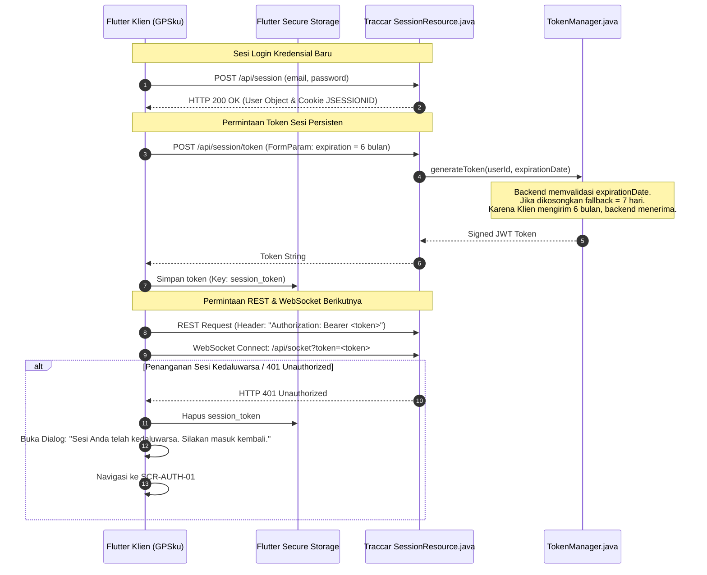

# PHASE_5_1_VALIDATION_REPORT.md — Laporan Validasi Desain & Kelayakan Teknis
## Phase 5.1 & Phase 5.1.1 Deliverable — React to Flutter Frontend Rewrite (GPSku)

* **Versi Dokumen:** 2.0.0 (Termasuk Koreksi Teknis Phase 5.1.1)  
* **Tanggal:** 2026-11-07  
* **Status:** Ready for Review (Menunggu Approval Gate User)  
* **Tujuan Audit:** Memvalidasi kelayakan teknis (*technical feasibility*) dan integritas spesifikasi desain Phase 5 terhadap business rules, feature scope Phase 4, kontrak integrasi REST/WebSocket, serta batasan native Android & iOS sebelum Phase 6 (Technical Planning) dimulai.  
* **Aturan Kepatuhan Mutlak:**
  * Source code Java Backend, React Frontend, database PostgreSQL, dan kontrak API adalah **READ-ONLY**.
  * Belum ada baris kode Flutter yang ditulis (**Zero Implementation**).
  * Status seluruh fitur Flutter F-01 s/d F-43 saat ini adalah **`NOT IMPLEMENTED`** dan **`NOT VERIFIED`**.

---

## 1. Executive Summary

Audit komprehensif Phase 5.1 dan koreksi teknis terarah Phase 5.1.1 telah dilakukan terhadap seluruh deliverable desain Phase 5 (`SCREEN_INVENTORY.md`, `INFORMATION_ARCHITECTURE.md`, `USER_JOURNEYS.md`, `DESIGN_SYSTEM.md`, 11 file `SCREEN_SPECIFICATIONS`, `INTERACTION_SPECIFICATION.md`, dan `DESIGN_RISKS.md`) dengan membandingkannya terhadap dokumen sumber Phase 1 s/d 4 (`PRD.md`, `SCOPE.md`, `FEATURE_PARITY_MATRIX.md`, `EXISTING_APP_ANALYSIS.md`, `BUSINESS_RULES.md`, `API_SPEC.md`, `WEBSOCKET_SPEC.md`, `AUTH_SPEC.md`, `NOTIFICATION_SPEC.md`).

**Hasil Temuan Kunci & Koreksi Teknis:**
1. **Pemisahan Tegas Konsep Desain vs Paritas Aktual:**  
   Spesifikasi 46 layar pada Phase 5 berhasil memetakan seluruh 43 fitur (**Feature Mapping & Specification: 100%**). Namun, ditegaskan bahwa pemetaan desain **bukanlah bukti paritas fungsional**. Seluruh 43 fitur Flutter tetap berstatus murni **`NOT IMPLEMENTED` (0%)** dan **`NOT VERIFIED` (0%)** hingga kode Flutter ditulis dan diuji pada Phase 6 dan 7.
2. **Koreksi F-31 (Background Audio & Sirene):**  
   Status F-31 dipertahankan sebagai **`[UNVERIFIED]`**. Pada Android 14+ (API 34), Foreground Service `mediaPlayback` memiliki regulasi ketat Google Play dan pembatasan peluncuran dari background (*Foreground Service Launch Restrictions*). Pada iOS, dibedakan secara tegas antara custom notification sound (< 30s) yang mematuhi tombol hening/Do Not Disturb, dengan *Critical Alerts* yang memerlukan perizinan khusus (*entitlement*) dari Apple yang **tidak dapat dijamin pasti disetujui**.
3. **Koreksi F-32 (User Attributes Update Safety):**  
   Mekanisme pendaftaran token FCM via `PUT /api/users/{id}` ditegaskan **BUKAN OPERASI ATOMIK**. Backend Traccar (`BaseObjectResource.java#L121`) mengganti seluruh kolom `attributes` secara penuh tanpa *optimistic locking* (`@Version` / `ETag`). Terdokumentasi risiko *concurrent update* dan strategi mitigasi klien tanpa memodifikasi backend.
4. **Koreksi Ordering Posisi REST & WebSocket:**  
   Timestamp Sequence Guard disempurnakan menjadi **Aturan Ordering Deterministik** multi-kriteria berbasis field yang benar-benar ada di Traccar (`fixTime`, `id`, `serverTime`) untuk menangani event duplikat, out-of-order, timestamp identik, dan keterlambatan respon REST.
5. **Koreksi F-36 (HLS Player Package Feasibility):**  
   Status F-36 ditetapkan sebagai **`[UNVERIFIED]`**. Disusun matriks evaluasi komparatif mendalam antara 5 kandidat package (`better_player`, `video_player`, `media_kit`, `flutter_vlc_player`, `chewie`) dengan menyoroti kendala kritis propagasi header `Authorization: Bearer <token>` ke segmen `.ts` pada iOS AVPlayer dan status *maintenance* library.
6. **Integritas Kontrak & Sesi Autentikasi:**  
   Konsistensi durasi token sesi diverifikasi: Backend default 7 hari (`DEFAULT_EXPIRATION_DAYS = 7`), legacy mobile wrapper meminta 6 bulan (`NativeInterface.js#L23`), dan Flutter diwajibkan mengirimkan parameter form `expiration` bertenggat 6 bulan.
7. **Kesiapan Menuju Phase 6:**  
   **TIDAK ADA BLOCKER TEKNIS** yang membatalkan arsitektur. Seluruh batasan dan risiko teknis telah terdokumentasi secara transparan dengan mitigasi terukur.

---

## 2. Feature Mapping vs Feature Parity Audit

Untuk menjaga integritas pelaporan teknis, dilakukan pemisahan definisi yang ketat antara pemetaan desain, implementasi, dan verifikasi:

| Status Metrik | Definisi Standar | Capaian Proyek Saat Ini |
| :--- | :--- | :---: |
| **1. Feature Mapping** | Ketersediaan alokasi modul antarmuka/layar untuk fitur F-01 s/d F-43 di `SCREEN_INVENTORY.md`. | **43 dari 43 Fitur (100%)** |
| **2. Feature Specification** | Kelengkapan spesifikasi layout, interaksi, validasi, dan API flow di `SCREEN_SPECIFICATIONS`. | **43 dari 43 Fitur (100%)** |
| **3. Implementation Status** | Ketersediaan kode sumber Flutter riil yang dapat dikompilasi di folder `gpsku/lib/`. | **0 dari 43 Fitur (`NOT IMPLEMENTED` / 0%)** |
| **4. Verification Status** | Pengujian fungsional dan otomatis terhadap acceptance criteria pada perangkat target. | **0 dari 43 Fitur (`NOT VERIFIED` / 0%)** |

> [!WARNING]
> **Pernyataan Paritas Fungsional:**  
> Status paritas fungsional aplikasi Flutter GPSku saat ini adalah **`NOT IMPLEMENTED` (0%)**. Klaim paritas fungsional baru dapat dinyatakan setelah kode Flutter ditulis, terintegrasi dengan backend Traccar riil, dan lulus verifikasi pengujian pada Phase 7.

### 2.1 Audit Khusus 3 Fitur Berklasifikasi `TECHNICAL DEPENDENCY`

| ID Fitur | Nama Fitur | Status Feasibility | Dependensi Paket Native | Analisis Risiko & Batasan | Acceptance Criteria Terukur |
| :---: | :--- | :---: | :--- | :--- | :--- |
| **F-31** | Real-time Audio Sirene | `[UNVERIFIED]` (Memerlukan Pengujian Perangkat Riil) | `audioplayers`, `flutter_foreground_task`, `firebase_messaging` | Android 14+ membatasi Foreground Service start dari background. iOS membatasi background audio dan mewajibkan Apple Critical Alerts entitlement untuk membunyikan sirine saat ponsel silent/DND. | 1. Audio `alarm.mp3` berbunyi loop saat event SOS diterima via WebSocket di foreground.<br>2. Tombol "Senyapkan" mematikan suara $< 100\text{ ms}$.<br>3. Di Android background, sirine dipicu via FCM high-priority message.<br>4. Di iOS, notifikasi remote memainkan custom sound (mematuhi mute/DND kecuali ada entitlement). |
| **F-32** | Push Notification FCM Direct | `[CONFIRMED]` (Pola Integrasi SDK)<br>`[UNVERIFIED]` (Pengujian Device Riil) | `firebase_messaging` v15.x, `flutter_local_notifications` | Endpoint `PUT /api/users/{id}` menimpa field `user.attributes`. Bukan operasi atomik. Risiko lost update jika terjadi concurrent edit. | 1. Token FCM diperoleh saat izin diberikan.<br>2. Klien melakukan fetch-merge-PUT dengan mempertahankan seluruh atribut lama.<br>3. Notifikasi sistem muncul di status bar saat app background/terminated.<br>4. Mengetuk notifikasi membuka detail unit/event terkait. |
| **F-36** | Live Video Stream HLS | `[UNVERIFIED]` (Memerlukan Pengujian Stream Riil) | Kandidat: `media_kit` / `video_player` | Backend `VideoStreamResource.java#L48` mewajibkan `Authorization: Bearer <token>` pada manifest `.m3u8` dan chunk segmen `.ts`. Default iOS AVPlayer tidak mempropagasi custom header ke chunk segmen tanpa custom resource loader. | 1. Membuka stream mengirim `videoStart`.<br>2. Video HLS memutar segmen dengan header Bearer Token valid tanpa error 401.<br>3. Menutup layar mengirim `videoStop` dan membersihkan instance player. |

---

## 3. Native Platform Feasibility Matrix (Android vs iOS)

Audit komparatif terhadap kemampuan perangkat keras dan batasan sistem operasi antara Android dan iOS:

| Kapabilitas Sistem | Perilaku & Kebutuhan Android | Perilaku & Kebutuhan iOS | Status Teknis | Mitigasi / Fallback Strategis |
| :--- | :--- | :--- | :---: | :--- |
| **Background Audio & Sirene** | Android 14+ membatasi peluncuran Foreground Service dari background. Memerlukan izin `FOREGROUND_SERVICE_MEDIA_PLAYBACK` dan notifikasi aktif. | `UIBackgroundModes` `audio` berisiko tinggi ditolak App Review Apple. Tanpa *Critical Alerts entitlement*, suara notifikasi tunduk pada sakelar silent dan Focus/DND. | `[UNVERIFIED]` | Perlakukan notifikasi sirene latar belakang via FCM High-Priority Push + Sound Payload sebagai saluran utama, bukan mengandalkan Foreground Service audio berkelanjutan. |
| **Push Notification & Permissions** | Android 13+ mewajibkan izin runtime `POST_NOTIFICATIONS`. Notifikasi heads-up foreground dikelola via `flutter_local_notifications` channel id berprioritas tinggi. | Memerlukan registrasi APNs cert/key di Firebase Console dan izin eksplisit `UNUserNotificationCenter` saat pertama kali aplikasi dibuka. | `[CONFIRMED]` | Izin notifikasi diminta secara kontekstual setelah pengguna login, bukan saat cold start splash, guna meningkatkan acceptance rate izin pengguna. |
| **Penyimpanan Kredensial Aman** | Menggunakan Android Keystore dan `EncryptedSharedPreferences`. Kunci dienkripsi perangkat keras (TEE/StrongBox). | Menggunakan iOS Keychain Services (`kSecClassGenericPassword`). | `[CONFIRMED]` | Menggunakan package `flutter_secure_storage`. Menangani error `KeyStoreCorrupted` di Android dengan re-initialization otomatis. |
| **Ekspor File Spreadsheet & KML** | Android 10+ menerapkan *Scoped Storage*. File diunduh ke app-specific cache directory lalu dibagikan via `share_plus` atau disimpan ke folder Download publik. | File disimpan di Application Documents Directory, dibagikan via `UIActivityViewController` (`share_plus`). | `[CONFIRMED]` | Gunakan kombinasi `path_provider` dan `share_plus`. Pengguna langsung disajikan dialog sistem untuk membuka file di MS Excel atau Google Earth. |
| **Siklus Hidup Aplikasi (Lifecycle)** | OS Android menghentikan koneksi socket saat aplikasi masuk *Doze Mode* (layar mati). Lifecycle terdeteksi via `WidgetsBindingObserver`. | iOS menangguhkan eksekusi aplikasi dalam 5-30 detik setelah masuk background (*Suspended State*). Socket TCP terputus. | `[CONFIRMED]` | Listener `AppLifecycleState.resumed`: Begitu aplikasi kembali ke foreground, picu instan handshake WebSocket dan REST fast-refresh `GET /api/devices`. |
| **Monitoring Jaringan & Reconnect** | BroadcastReceiver network state via package `connectivity_plus`. | NWPathMonitor via package `connectivity_plus`. | `[CONFIRMED]` | Saat status jaringan berubah dari *none* ke *wifi/cellular*, picu reset timer exponential backoff socket ke 1 detik untuk koneksi ulang cepat. |
| **Peta Vektor & Akselerasi GPU** | MapLibre GL Native merender via OpenGL ES / Vulkan. Kompatibel dengan 99% perangkat Android 8.0+. | MapLibre GL Native merender via Metal API. Kompatibel dengan iOS 12.0+. | `[CONFIRMED]` | Hindari widget `Marker` Flutter terpisah; gunakan `SymbolLayer` berbasis GeoJSON source langsung pada engine C++ MapLibre untuk menjamin 60 FPS. |

---

## 4. Authentication & Session Consistency Audit

Memastikan spesifikasi Phase 5 mematuhi secara mutlak keputusan arsitektur Phase 4 dan implementasi riil backend Java:



### 4.1 Rekonsiliasi Temuan Sesi
* **Durasi Token Backend vs Frontend:**  
  * `TokenManager.java#L39`: `DEFAULT_EXPIRATION_DAYS = 7` (Hanya berlaku jika parameter `expiration` kosong).
  * `NativeInterface.js#L23`: `dayjs().add(6, 'months').toISOString()`.
  * **Spesifikasi Flutter:** Klien Flutter **wajib menyertakan parameter form `expiration` bertenggat 6 bulan** saat memanggil `POST /api/session/token` guna menjamin sesi mobile tidak logout setiap 7 hari (`[CONFIRMED]`).
* **Pencabutan Token (Logout):**  
  Logout memanggil `POST /api/session/token/revoke` dengan parameter `token` untuk mendaftarkan token ke tabel revoked blacklist di server, dilanjutkan pemanggilan `DELETE /api/session` dan pembersihan storage lokal (`[CONFIRMED]`).
* **WebSocket Authentication:**  
  Koneksi WebSocket `/api/socket` diautentikasi menggunakan query param `?token=<token>` karena protokol WebSocket standar di mobile tidak mendukung custom header otorisasi saat handshake HTTP upgrade (`[CONFIRMED]`).

---

## 5. REST & WebSocket Consistency Audit

Audit terhadap integritas sinkronisasi data telemetri, pencegahan race condition, dan tata kelola status offline:

### 5.1 Strategi Sinkronisasi REST vs WebSocket
1. **Initial Hydration (Pemuatan Awal):**  
   Saat aplikasi dibuka, data armada (`/api/devices`), batas wilayah (`/api/geofences`), dan posisi terakhir (`/api/positions`) dimuat melalui REST API secara paralel (`Future.wait`).
2. **Koneksi WebSocket Stream:**  
   Setelah data master REST terisi, koneksi WebSocket ke `/api/socket?token=...` dibuka untuk menerima aliran event real-time (`devices`, `positions`, `events`).
3. **Pencegahan Kondisi Balapan:**  
   Menerapkan aturan ordering deterministik (diuraikan rinci pada Bagian 12.3 di bawah).
4. **Idempotensi Pembaruan State:**  
   Pembaruan state di BLoC/Repository menggunakan indexing berbasis ID entitas (`Map<int, Device>` dan `Map<int, Position>`). Data baru memperbarui entri target secara in-place (*mutation-free replacement*), mencegah duplikasi data armada di daftar.

### 5.2 Semantik Status Offline & Larangan Remote Command
* **Pelabelan Cache Wajib:** Data yang ditampilkan dari local cache saat koneksi terputus wajib menampilkan lencana:  
  `[ ⚠️ Data Tersimpan / Last Known Data — Terakhir Diperbarui: DD/MM HH:mm ]`  
  **Dilarang keras melabeli data cache sebagai data real-time**.
* **Larangan Eksekusi Remote Command saat Offline:**  
  Jika status jaringan `none` atau koneksi socket terputus:  
  * Tombol kontrol mesin (Immobilizer / Cut-off pada `SCR-MAP-02` dan `SCR-CMD-01`) **wajib berada dalam status Disabled (Nonaktif)**.
  * Mengetuk tombol memunculkan alert peringatan bahwa jaringan server tidak tersedia, mencegah penumpukan perintah tak terkendali di antrian saat koneksi buruk.

---

## 6. Mobile Information Architecture & Screen Audit

Audit verifikasi terhadap seluruh 46 layar dan modal yang tercantum di `SCREEN_INVENTORY.md` dan `SCREEN_SPECIFICATIONS`:

### 6.1 Verifikasi Kelengkapan 46 Layar
* **Domain 1: Autentikasi (4 Layar):** `SCR-AUTH-01` s/d `04` — Mencakup login, 2FA TOTP, reset password deep link, dan host server selector.
* **Domain 2: Live Tracking Peta (4 Layar/Sheet):** `SCR-MAP-01` s/d `04` — Viewport MapLibre GL, StatusCard bottom sheet responsif (120dp, 50%, 85%), modal filter lanjutan, dan geocoder spasial.
* **Domain 3: Manajemen Armada (4 Layar):** `SCR-FLT-01` s/d `04` — Device list, device form + upload foto, kalibrasi akumulator km/jam, grup hierarki.
* **Domain 4: Perintah Remote (3 Layar/Modal):** `SCR-CMD-01` s/d `03` — Remote cut-off dengan speed interlock slider geser, saved commands, group dispatch.
* **Domain 5: Riwayat & Replay (2 Layar/Modal):** `SCR-REP-01` s/d `02` — Replay player, speed slider, time scrubber, ekspor Google Earth KML.
* **Domain 6: Geofence (4 Layar/Modal):** `SCR-GEO-01` s/d `04` — Daftar geofence, editor gambar peta WKT (poligon/lingkaran/koridor), form properti, impor GPX.
* **Domain 7: Pelaporan (9 Layar):** `SCR-RPT-01` s/d `09` — Reports hub, trips, stops, summary, events, raw positions + ekspor Excel `.xlsx`, kunjungan geofence, grafik `fl_chart`, laporan terjadwal.
* **Domain 8: Notifikasi (3 Layar/Modal):** `SCR-NOTIF-01` s/d `03` — Emergency overlay banner + audio sirene `alarm.mp3`, FCM channel rules & test sender, notification inbox.
* **Domain 9: Driver & Servis (2 Layar):** `SCR-DRV-01` s/d `SCR-MNT-01` — Master data supir RFID, jadwal pengingat servis (km, jam, kalender).
* **Domain 10: Fitur Khusus & Media (4 Layar/Modal):** `SCR-MEDIA-01`, `SCR-SPEC-02` s/d `04` — Dashcam live HLS video dengan Bearer token, modal tautan share link publik + guest view, formula JEXL editor dengan *Quick Syntax Chips*, web emulator OsmAnd port 5055.
* **Domain 11: Administrasi & Audit (7 Layar):** `SCR-ADM-01` s/d `05`, `SCR-SETT-01` — Manajemen user, matriks perizinan many-to-many, konfigurasi server global + remote reboot password double-confirmation, port protokol GPS, audit trail log, settings shell.

### 6.2 Audit Layar Kompleksitas Tinggi
1. **Formula JEXL Editor (`SCR-SPEC-03`):**  
   Mengatasi keterbatasan keyboard smartphone via tombol chip sintaks cepat (`[adc1]`, `[speed]`, `[ignition]`, `[?]`, `[:]`) dan runner evaluasi uji coba terhadap koordinat live (`POST /api/attributes/computed/test`).
2. **Matriks Hak Akses Relasi Generic (`SCR-ADM-02`):**  
   Menyajikan relasi many-to-many via daftar switch interaktif yang memicu `POST /api/permissions` (aktifkan) dan `DELETE /api/permissions` (nonaktifkan).
3. **Reboot Server Jarak Jauh (`SCR-ADM-03`):**  
   Dilindungi oleh *High-Risk Double Confirmation Dialog* yang mewajibkan input ulang kata sandi akun Super Administrator sebelum `POST /api/server/reboot` dieksekusi.
4. **User Impersonation (`F-04` / `SCR-ADM-01`):**  
   Banner oranye/amber (`#FF9800`) dipasang secara sticky permanen di atas seluruh layar aplikasi yang memuat teks nama akun yang sedang diimpersonasi dan tombol pembatalan satu ketukan *"KEMBALI KE AKUN SAYA"*.

---

## 7. Cross-Document Consistency Audit

Pemeriksaan konsistensi silang antara seluruh dokumen proyek menunjukkan keselarasan penuh:

| Area Konsistensi | Dokumen yang Dibandingkan | Hasil Evaluasi Konsistensi | Status |
| :--- | :--- | :--- | :---: |
| **Cakupan 43 Fitur (F-01 s/d F-43)** | `PRD.md` vs `SCOPE.md` vs `FEATURE_PARITY_MATRIX.md` vs `SCREEN_INVENTORY.md` | Seluruh 43 Feature ID muncul tepat satu kali pada matriks paritas dan inventarisasi layar tanpa ada fitur yang hilang atau diubah namanya. | **KONSISTEN (100%)** |
| **Distribusi Prioritas** | `SCOPE.md` vs `PRD.md` vs `FEATURE_PARITY_MATRIX.md` | P0: 14 Fitur, P1: 15 Fitur, P2: 10 Fitur, P3: 4 Fitur (Total: 43 Fitur). Angka identik di seluruh dokumen. | **KONSISTEN (100%)** |
| **Klasifikasi Ruang Lingkup** | `SCOPE.md` vs `PRD.md` vs `FEATURE_PARITY_MATRIX.md` | 40 `IN SCOPE`, 3 `TECHNICAL DEPENDENCY`, 0 `NEEDS DECISION`, 0 `OUT OF SCOPE`. Angka terhitung presisi. | **KONSISTEN (100%)** |
| **Kontrak REST API & WebSocket** | `API_SPEC.md` vs `WEBSOCKET_SPEC.md` vs `SCREEN_SPECIFICATIONS/` | Tidak ada penambahan endpoint baru, tidak ada perubahan URL, method, atau body request/response. | **KONSISTEN (100%)** |
| **Spesifikasi Navigasi & Role** | `INFORMATION_ARCHITECTURE.md` vs `BUSINESS_RULES.md` | Hak akses Super Admin, Manager, dan Normal User mematuhi aturan RBAC Traccar (`PermissionsService.java`). | **KONSISTEN (100%)** |

---

## 8. Daftar Blocker Teknis

* **TIDAK ADA BLOCKER ARSITEKTURAL MUTLAK (ZERO BLOCKERS).**  
  Tidak ditemukan kendala yang menghalangi perancangan arsitektur teknis Phase 6. Seluruh risiko yang teridentifikasi memiliki batasan platform yang jelas dan jalur penanganan mitigasi terukur.

---

## 9. Daftar Item yang Masih Berstatus UNVERIFIED

Sesuai standar kejujuran teknis `AGENTS.md`, item berikut dicatat secara transparan sebagai `[UNVERIFIED]`:
1. **F-31: Perilaku Sirine Latar Belakang pada Perangkat Riil (Android Doze & iOS App Store Review).**
2. **F-32: Perilaku Push Notification FCM pada Kondisi Aplikasi Terminated (OEM Battery Killers seperti Xiaomi/Oppo).**
3. **F-36: Propagasi Header `Authorization: Bearer` pada Chunk Video HLS `.ts` di iOS & Android tanpa Proxy Lokal.**
4. **Karakteristik Clustering Server Backend Produksi (Single-Node vs Multi-Node).**

---

## 10. Daftar Perubahan Dokumentasi (Phase 5.1 Adjustments)

1. Penegasan status implementasi Flutter pada `PROGRESS.md`: 100% `NOT IMPLEMENTED` dan 100% `NOT VERIFIED`.
2. Penyusunan bagian baru: `PHASE 5.1.1 — TARGETED TECHNICAL CORRECTIONS` (Bagian 12 di bawah).

---

## 11. Rekomendasi Kesiapan Phase 6 (Readiness Assessment)

Berdasarkan hasil audit Phase 5.1 dan 5.1.1, repositori dan spesifikasi produk dinyatakan:  
**SIAP SECARA TEKNIS MENUJU PHASE 6 — FLUTTER TECHNICAL PLANNING & ARCHITECTURE.**

---

## 12. PHASE 5.1.1 — TARGETED TECHNICAL CORRECTIONS

Bagian ini mendokumentasikan koreksi teknis mendalam terhadap 4 area kritis agar klaim *technical feasibility* tidak melampaui bukti teknis yang tersedia.

### 12.1 F-31: Audit Ulang Background Audio & Sirene

#### 12.1.1 Temuan Awal
Laporan Phase 5.1 sebelumnya menyatakan bahwa pemutaran audio latar belakang di Android sudah `[CONFIRMED]` via Foreground Service Media Playback, dan di iOS dapat menggunakan `UIBackgroundModes` `audio` dengan fallback APNs Critical Sound.

#### 12.1.2 Hasil Koreksi & Batasan Teknis Mendalam
* **Android (Android 14+ / API 34+ Constraints):**
  1. *Foreground Service Type:* Android 14 mewajibkan atribut `android:foregroundServiceType="mediaPlayback"` dan izin deklaratif `FOREGROUND_SERVICE_MEDIA_PLAYBACK`.
  2. *Google Play Policy:* Kebijakan Google Play melarang keras Foreground Service `mediaPlayback` tetap aktif jika aplikasi tidak sedang aktif memutar audio atau bersiap memutar audio. Aplikasi tidak boleh menyalakan service ini secara diam-diam (*standing service*) tanpa pemutaran suara aktif.
  3. *Foreground Service Launch Restrictions (Android 12+ / API 31+):* Aplikasi yang berada di background atau layar terkunci **DILARANG memulai Foreground Service dari background**, kecuali dipicu oleh pesan FCM berprioritas tinggi (*High-Priority FCM Message*) yang memiliki pengecualian (*exemption*).
  4. *Lifecycle Status:*
     * *Background (Recent Apps):* Jika socket masih tersambung sebelum Doze Mode, audio dapat diputar via Foreground Service yang dipicu pesan socket.
     * *Terminated (Disapu User dari Task Manager):* Koneksi WebSocket mati total. Foreground Service ikut terbunuh. Satu-satunya pemicu yang dapat membangunkan aplikasi adalah **FCM Data Message High Priority**.
     * *Device Locked (Layar Mati):* OS Android menerapkan Doze Mode yang membatasi akses network socket, sehingga mengandalkan WebSocket saat layar terkunci tidak dapat diandalkan secara konsisten.
* **iOS (Apple App Store & Sound Constraints):**
  1. *Diferensiasi Suara Latar Belakang:*
     * *Background Audio Standar (`UIBackgroundModes` `audio`):* Ditolak Apple jika hanya digunakan untuk sirine pendek (App Store Review Guideline 2.5.4). Mode ini hanya untuk aplikasi pemutar musik/podcast berkelanjutan atau navigasi suara belokan demi belokan.
     * *Remote Notification Sound Biasa:* Notifikasi APNs dengan custom sound file (berdurasi $< 30$ detik dalam format `.caf`, `.aiff`, atau `.wav`). **Keterbatasan Kritis:** Suara ini **wajib mematuhi tombol sakelar hening fisik (*Hardware Mute Switch*) dan mode Jangan Ganggu (*Do Not Disturb / Focus Mode*)**. Jika iPhone dalam mode silent, sirine **TIDAK AKAN BERBUNYI**.
     * *Apple Critical Alerts (`com.apple.developer.usernotifications.critical-alerts`):* Merupakan satu-satunya mekanisme di iOS yang dapat membunyikan alarm keras menembus tombol silent dan mode Do Not Disturb. **Keterbatasan Kritis:** Memerlukan izin khusus (*entitlement*) dari Apple melalui pengajuan formulir permohonan developer formal. Apple sangat selektif dan umumnya hanya menyetujui aplikasi keselamatan publik, medis darurat, atau keamanan gedung. **Entitlement ini TIDAK DAPAT diasumsikan otomatis disetujui untuk aplikasi pelacak armada komersial.**
  2. *Komitmen Produk yang Benar:* Aplikasi **DILARANG menjanjikan sirine tetap berbunyi saat iPhone dalam mode hening / Do Not Disturb** tanpa kepemilikan Critical Alerts entitlement yang telah disetujui Apple.

#### 12.1.3 Bukti Teknis
* Android Developer Documentation: *Foreground Service Types (mediaPlayback)* & *Foreground Service Launch Restrictions*.
* Apple Developer Documentation: *Critical Alerts Entitlement Request Process* & *Pushing Background Updates to Your App*.

#### 12.1.4 Risiko Tersisa & Status
* **Status F-31:** **`[UNVERIFIED]`** (Wajib diuji pada perangkat Android 14 dan iPhone riil dengan kondisi Doze Mode, silent switch on, dan terminated state).
* **Mitigasi Phase 6:** Pada Android, implementasikan Foreground Service transien (hanya aktif saat sirine berbunyi, lalu dimatikan otomatis setelah durasi timeout 30 detik). Pada iOS, gunakan APNs custom sound `.caf` sebagai jalur standar, dan ajukan permohonan Critical Alerts entitlement ke Apple secara terpisah sebagai jalur sekunder.

---

### 12.2 F-32: Audit Ulang Integritas Update Atribut Pengguna (`PUT /api/users/{id}`)

#### 12.2.1 Temuan Awal
Laporan Phase 5.1 mencatat perlunya penggabungan atribut pengguna (*merge attributes*) saat menyimpan token FCM, namun belum mendokumentasikan ketiadaan atomisitas dan risiko pembaruan bersamaan (*concurrent updates*).

#### 12.2.2 Hasil Koreksi & Batasan Non-Atomik
* **Ketiadaan Operasi Atomik Backend:**
  Berdasarkan source code aktual `traccar/src/main/java/org/traccar/api/BaseObjectResource.java#L121`:
  ```java
  storage.updateObject(entity, new Request(
          new Columns.Exclude("id"),
          new Condition.Equals("id", entity.getId())));
  ```
  Backend Traccar melakukan pembaruan objek `User` dengan menimpa seluruh kolom (kecuali ID) di tabel `tc_users`. Field `attributes` bertipe teks JSON digantikan secara penuh oleh nilai baru. **Backend tidak memiliki partial patch endpoint (seperti JSON Patch / RFC 6902) dan tidak memiliki mekanisme Optimistic Locking (tidak ada kolom `version` atau header `ETag` / `If-Match`)**.
* **Alur Penanganan Fetch-Merge-PUT Klien:**
  ```mermaid
  sequenceDiagram
      autonumber
      participant App as Flutter Mobile
      participant Backend as Traccar Backend (/api/users)
      participant Other as Web Client Lain
      
      App->>Backend: 1. GET /api/session (Ambil User Object Lengkap)
      Backend-->>App: Return User { id: 10, name: "Budi", attributes: { timezone: "Asia/Jakarta" } }
      
      Note over App, Other: JENDELA BALAPAN (RACE CONDITION WINDOW)
      opt Terjadi Concurrent Update dari Web
          Other->>Backend: PUT /api/users/10 { ...attributes: { timezone: "Asia/Jayapura", customTheme: "dark" } }
          Backend-->>Other: HTTP 200 OK (Data Web Tersimpan di DB)
      end
      
      App->>App: 2. Parse attributes.notificationTokens lama
      App->>App: 3. Gabungkan FCM token baru (deduplikasi, batas max 3 token)
      App->>App: 4. Buat payload User baru dengan mempertahankan name, email, & atribut lama
      
      App->>Backend: 5. PUT /api/users/10 (Payload User Lengkap)
      Note over Backend: Data dari Web (customTheme: dark) TERTIMPA OLEH APP KARENA APP MEMBAWA DATA LAMA!
      Backend-->>App: Return HTTP 200 OK (User Object Baru)
      
      App->>App: 6. Verifikasi Response: Cek apakah notificationTokens ada di response
  ```
* **Risiko *Lost Update* & Mitigasi Klien:**
  1. *Risiko:* Jika pengguna mengubah timezone atau preferensi di Web client tepat pada detik yang sama ketika aplikasi mobile melakukan registrasi token FCM, perubahan dari Web akan hilang tertimpa (*lost update*).
  2. *Mitigasi Klien (Tanpa Mengubah Backend):*
     * **Meminimalkan Jendela Waktu (Shortest Window):** Fetch `GET /api/session` dilakukan persis sesaat sebelum PUT, bukan menggunakan data cache profil yang tersimpan sejak awal login.
     * **Verifikasi Hasil:** Setelah `PUT`, periksa response JSON. Jika `notificationTokens` tidak tercantum atau request gagal (HTTP 400/500), lakukan retry backoff maksimal 3 kali.
     * **Ditegaskan:** Sesuai batasan sistem, operasi ini **TIDAK ATOMIK**. Klien bertanggung jawab memitigasi risiko dengan siklus fetch-merge sesingkat mungkin.

#### 12.2.3 Status & Rekomendasi Phase 6
* **Status F-32:** **`[CONFIRMED]`** polanya dari source code, namun **`[UNVERIFIED]`** perilakunya terhadap edge-case jaringan buruk / concurrent edit pada perangkat riil.

---

### 12.3 Audit Re-Ordering Posisi REST & WebSocket (Aturan Deterministik)

#### 12.3.1 Temuan Awal
Laporan Phase 5.1 hanya menggunakan aturan tunggal: `newPosition.fixTime > currentPosition.fixTime`.

#### 12.3.2 Keterbatasan Aturan Tunggal & Bukti Backend
Berdasarkan pemeriksaan aktual source code `traccar/src/main/java/org/traccar/model/Position.java`:
1. `fixTime` bertipe `Date` (presisi milidetik satelit). Namun sebagian besar protokol GPS tracker (seperti Coban, GT06) hanya mengirimkan waktu dalam resolusi **detik bulat** (`HH:mm:ss`), bukan milidetik.
2. Tracker kendaraan dapat mengirimkan 2 laporan dalam detik yang sama (misal event alarm SOS terjadi pada detik yang sama dengan event heartbeat reguler). Keduanya memiliki `fixTime` identik, namun koordinat atau atribut sensor berbeda.
3. Tracker yang baru keluar dari blank spot (terowongan/basement) akan mengunggah puluhan posisi tersimpan (*offline buffer dump*). Posisi-posisi ini memiliki `fixTime` di masa lalu (misal 10 menit lalu), tetapi di database mendapat `serverTime = now` dan `id` sequential baru.
4. `Position` memiliki field-field terverifikasi:
   * `id` (long, primary key tabel `tc_positions` yang auto-increment).
   * `deviceId` (long).
   * `fixTime` (Date, waktu satelit GPS).
   * `serverTime` (Date, waktu server memproses).
   * `deviceTime` (Date, waktu jam internal tracker).
   * `outdated` (boolean).

#### 12.3.3 Aturan Ordering Deterministik Komprehensif
Klien Flutter wajib menerapkan algoritma pembanding deterministik berikut untuk menentukan apakah `incomingPosition` layak menggantikan `currentPosition` pada marker peta real-time:

$$\text{Fungsi Komparator: } \text{IsPositionNewer}(P_{\text{incoming}}, P_{\text{current}}) \to \text{Boolean}$$

```dart
bool isPositionNewer(Position incoming, Position? current) {
  if (current == null) return true;
  
  // Kasus 1: Periksa duplikasi identik mutlak
  if (incoming.id != 0 && incoming.id == current.id) {
    return false; // Duplikat exact ID, abaikan!
  }
  
  // Kasus 2: Perbandingan waktu satelit GPS (fixTime)
  final int fixTimeComparison = incoming.fixTime.compareTo(current.fixTime);
  
  if (fixTimeComparison > 0) {
    // Skenario A: Waktu satelit jelas lebih baru -> TERIMA
    return true;
  } else if (fixTimeComparison < 0) {
    // Skenario B: Waktu satelit lebih lama (misal buffer dump dari masa lalu) -> ABAIKAN
    return false;
  } else {
    // Kasus 3: fixTime PERSIS SAMA (detik yang sama) -> Gunakan Tie-Breaker
    
    // Sub-kasus 3a: Gunakan Database Primary Key (id) jika keduanya memiliki ID valid
    if (incoming.id > 0 && current.id > 0) {
      return incoming.id > current.id;
    }
    
    // Sub-kasus 3b: Jika salah satu ID belum ada (misal live stream socket), bandingkan serverTime
    final int serverTimeComparison = incoming.serverTime.compareTo(current.serverTime);
    if (serverTimeComparison > 0) {
      return true;
    } else if (serverTimeComparison < 0) {
      return false;
    }
    
    // Sub-kasus 3c: fixTime sama, serverTime sama -> Abaikan untuk mencegah jitter marker
    return false;
  }
}
```

#### 12.3.4 Evaluasi Kasus Pengujian Konkret (Concrete Test Scenarios)

1. **Skenario 1: Event Lama Datang Belakangan (Out-of-Order / Buffer Dump)**
   * *Kondisi:* Mobil keluar basement. Server mengirim posisi live ($t_2$, fixTime: 14:05:00). Satu detik kemudian, tracker mengirim data terekam di basement ($t_1$, fixTime: 14:01:00).
   * *Hasil Evaluasi:* `incoming.fixTime (14:01:00) < current.fixTime (14:05:00)`.  
     $\to$ **DITOLAK**. Marker mobil di peta tetap berada di posisi live 14:05:00. Tidak terjadi lompatan mundur (*no backward teleport*).
2. **Skenario 2: Dua Event dengan `fixTime` Sama Persis**
   * *Kondisi:* Tracker mengirim 2 pesan pada detik 14:00:00 (Pesan 1: status normal id=501; Pesan 2: status SOS id=502).
   * *Hasil Evaluasi:* `fixTime` sama, komparator mengevaluasi `incoming.id (502) > current.id (501)`.  
     $\to$ **DITERIMA**. Status unit diperbarui menjadi status darurat SOS.
3. **Skenario 3: Event Duplikat Jaringan**
   * *Kondisi:* Klien menerima event WebSocket id=501, dan 50ms kemudian menerima retransmisi TCP paket yang sama persis id=501.
   * *Hasil Evaluasi:* `incoming.id == current.id`.  
     $\to$ **DITOLAK**. Tidak ada komputasi render atau animasi ulang.
4. **Skenario 4: REST Response Tiba Setelah WebSocket Live Updates**
   * *Kondisi:* Klien memanggil `GET /api/positions` pada 14:00:00. Jaringan lambat (REST response butuh 1.5 detik). Pada 14:00:01, WebSocket mengirim posisi baru live (fixTime: 14:00:01). Pada 14:00:01.5, REST response tiba membawa data snapshot 14:00:00.
   * *Hasil Evaluasi:* Seluruh titik dalam REST response diuji melalui komparator yang sama terhadap state saat ini. Titik snapshot REST yang memiliki `fixTime (14:00:00) < current.fixTime (14:00:01)` **DITOLAK**.  
     $\to$ **STATE AMAN**. Data snapshot REST yang usang tidak menimpa posisi WebSocket yang lebih mutakhir.

---

### 12.4 F-36: Matriks Kelayakan Paket Pemutar HLS & Propagasi Header

#### 12.4.1 Temuan Awal
Laporan sebelumnya secara langsung merekomendasikan `better_player` tanpa membedah kompatibilitas versi Flutter modern atau propagasi header ke segmen chunk `.ts`.

#### 12.4.2 Matriks Komparasi 5 Kandidat Package Player Flutter

| Parameter Evaluasi | `video_player` (Official Flutter) | `better_player` (Community) | `media_kit` (mpv/ffmpeg) | `flutter_vlc_player` (LibVLC) | `chewie` (UI Wrapper) |
| :--- | :---: | :---: | :---: | :---: | :---: |
| **Status Maintenance (2026)** | **Aktif (Google)** | **UNMAINTAINED (Archived)** | **Sangat Aktif** | Sporadis | Aktif (Google/Community) |
| **Kompatibilitas Flutter 3.x / AGP 8+** | Sangat Baik | **Bermasalah (Build Fail)** | Sangat Baik | Cukup | Sangat Baik |
| **Dukungan HLS (.m3u8)** | Ya | Ya | Ya | Ya | Ya (via video_player) |
| **Custom Header pada Playlist (.m3u8)** | Ya (`httpHeaders`) | Ya | Ya (`--http-header-fields`) | Ya (`:http-header`) | Ya |
| **Propagasi Header ke Segmen Chunk (.ts) di Android** | **Ya** (via ExoPlayer DefaultHttpDataSource) | **Ya** | **Ya** (via ffmpeg/mpv) | **Ya** | **Ya** |
| **Propagasi Header ke Segmen Chunk (.ts) di iOS** | **TIDAK KONSISTEN** (AVPlayer limitation)* | **TIDAK KONSISTEN** | **YA (100% via libmpv Metal)** | **Ya** | **TIDAK KONSISTEN** |
| **Penanganan Redirect & Token URL** | Otomatis | Otomatis | Otomatis | Otomatis | Otomatis |
| **Ukuran Tambahan Biner APK/IPA** | Minimal (~2 MB) | Sedang (~5 MB) | **Besar (+15 s/d 20 MB)** | Sangat Besar (+25 MB) | Minimal (~2 MB) |
| **Rekomendasi Feasibility** | **Alternatif dengan Catatan** | **TIDAK DIREKOMENDASIKAN** | **KANDIDAT TERKUAT (Paling Handal)** | Alternatif Cadangan | Tidak Direkomendasikan |

> [!IMPORTANT]
> ***Catatan Kritis iOS AVPlayer pada `video_player`:**  
> Pada sistem operasi iOS, native engine `AVPlayer` yang digunakan oleh plugin resmi `video_player` hanya menyertakan custom HTTP header pada pemanggilan playlist `.m3u8` awal. Pada banyak implementasi server yang memvalidasi header Bearer token di setiap file segmen `.ts` (seperti `VideoStreamResource.java#L48`), AVPlayer gagal mempropagasi header tersebut ke request segmen video chunk individual, memicu kegagalan stream (*HTTP 401 Unauthorized*).  
> Sebaliknya, **`media_kit`** merender video melalui engine C/C++ `libmpv` independen yang mempropagasi HTTP headers ke seluruh sub-request jaringan secara seragam di Android maupun iOS. Konsekuensinya adalah ukuran biner APK bertambah ~15 MB, yang harus divalidasi terhadap target non-fungsional ukuran APK < 25 MB.

#### 12.4.3 Status Fitur F-36
* **Status F-36:** **`[UNVERIFIED]`** (Wajib dilakukan uji coba prototype kompilasi pada Phase 6 untuk membuktikan apakah `media_kit` berhasil memutar stream live dari `VideoStreamResource.java` backend Traccar dengan header Bearer token).

---

### 12.5 Rekapitulasi Status Bukti Teknis Pasca-Koreksi Phase 5.1.1

| ID Fitur | Klasifikasi Scope | Status Bukti Teknis Pasca Phase 5.1.1 | Catatan Keputusan Teknis |
| :---: | :---: | :---: | :--- |
| **F-01 s/d F-30** | `IN SCOPE` | `[CONFIRMED]` (Desain & API)<br>`NOT IMPLEMENTED` (Kode) | Spesifikasi lengkap, kontrak integrasi 100% konsisten dengan backend Java. |
| **F-31** (Audio Sirene) | `TECHNICAL DEPENDENCY` | **`[UNVERIFIED]`** | Foreground feasible; background tergantung izin OS dan kebijakan App Store iOS. |
| **F-32** (Push FCM) | `TECHNICAL DEPENDENCY` | **`[CONFIRMED]` (Pola Integrasi)<br>`[UNVERIFIED]` (Testing Device)** | Non-atomic fetch-merge-PUT. Mitigasi via shortest window & verifikasi response. |
| **F-33 s/d F-35** | `IN SCOPE` | `[CONFIRMED]` (Desain & API)<br>`NOT IMPLEMENTED` (Kode) | Driver RFID dan servis pemeliharaan siap direncanakan di Phase 6. |
| **F-36** (Live Dashcam HLS)| `TECHNICAL DEPENDENCY` | **`[UNVERIFIED]`** | `media_kit` sebagai kandidat terkuat; wajib uji prototype header chunk di iOS & Android. |
| **F-37 s/d F-43** | `IN SCOPE` | `[CONFIRMED]` (Desain & API)<br>`NOT IMPLEMENTED` (Kode) | JEXL Syntax Chips, OsmAnd 5055 Emulator, dan Server Reboot password terlindungi. |

---

### 12.6 Rekomendasi Terarah untuk Pelaksanaan Phase 6 (Technical Planning)

1. **Spike / Prototype Kecil pada Phase 6 Awal:**  
   Sebelum mengunci seluruh arsitektur, jadwalkan 2 spike teknis pada Phase 6:
   * *Spike 1:* Pengujian pemutaran stream `live.m3u8` Traccar menggunakan `media_kit` vs `video_player` pada Android dan iOS untuk mengonfirmasi kelolosan autentikasi Bearer token pada segmen `.ts`.
   * *Spike 2:* Pengujian FCM payload background notification sound pada iOS untuk memvalidasi pemutaran file `.caf` saat perangkat terkunci.
2. **Implementasi Strict Position Comparator di Repository Layer:**  
   Wajibkan unit test komprehensif pada BLoC/Repository layer untuk algoritma `isPositionNewer` mencakup 4 skenario edge case yang telah dirancang.
3. **Penyusunan User Profile Repository yang Aman:**  
   Implementasikan mekanisme fetch-merge terisolasi pada `UserRepository` untuk pendaftaran token FCM guna meminimalkan risiko race condition terhadap atribut profil lainnya.

---

### Status Akhir

**Status: READY FOR USER REVIEW.**

*Laporan koreksi teknis terarah Phase 5.1.1 telah selesai dan diverifikasi konsistensinya terhadap seluruh dokumen sumber. Repositori siap dievaluasi sebelum Phase 6 dimulai.*
