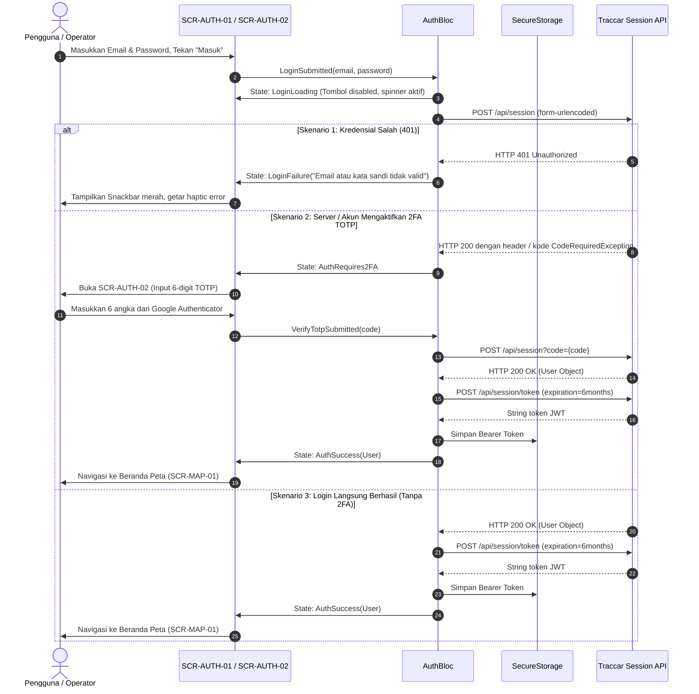
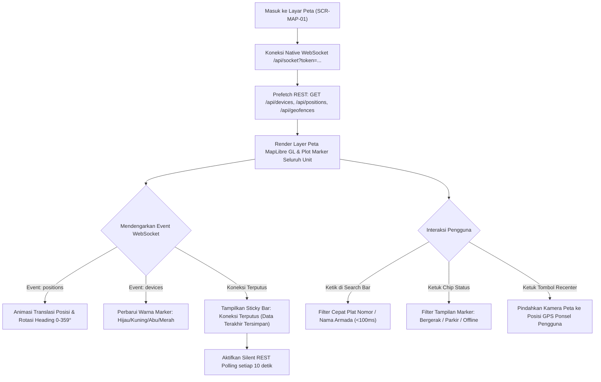
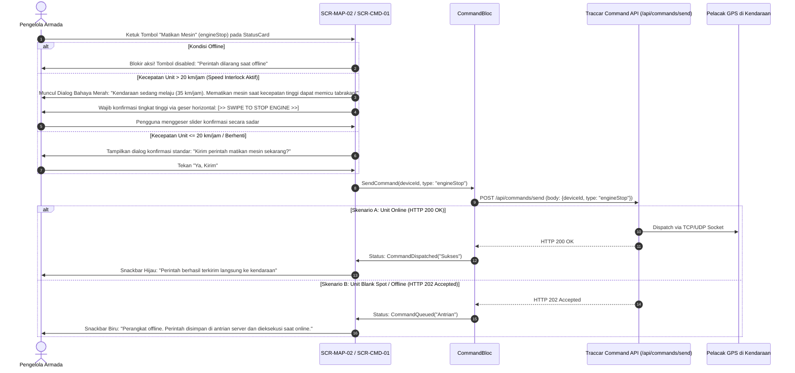
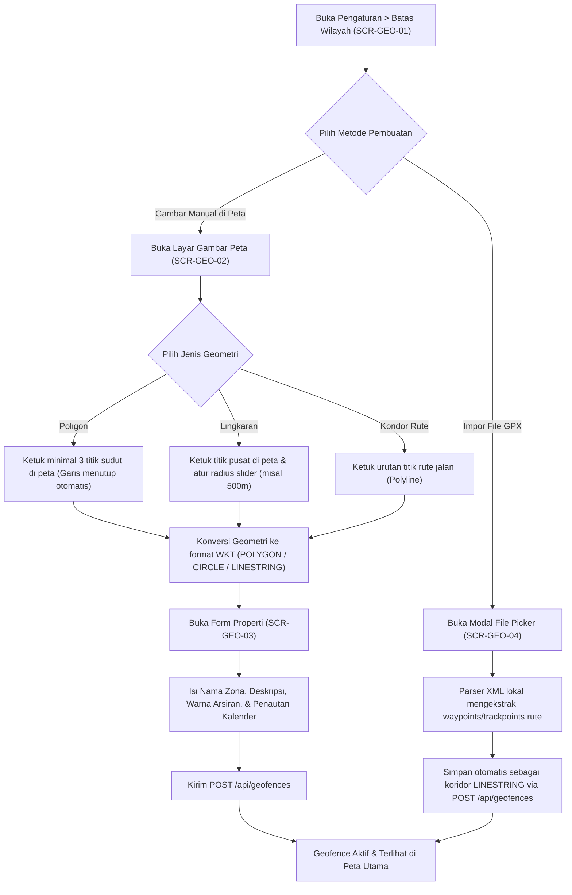
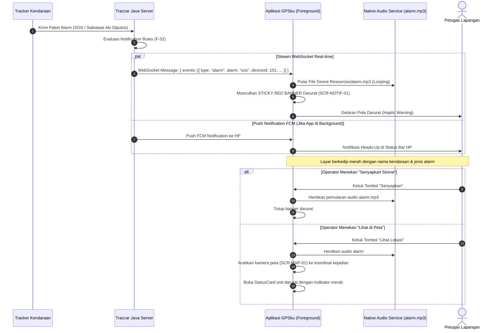
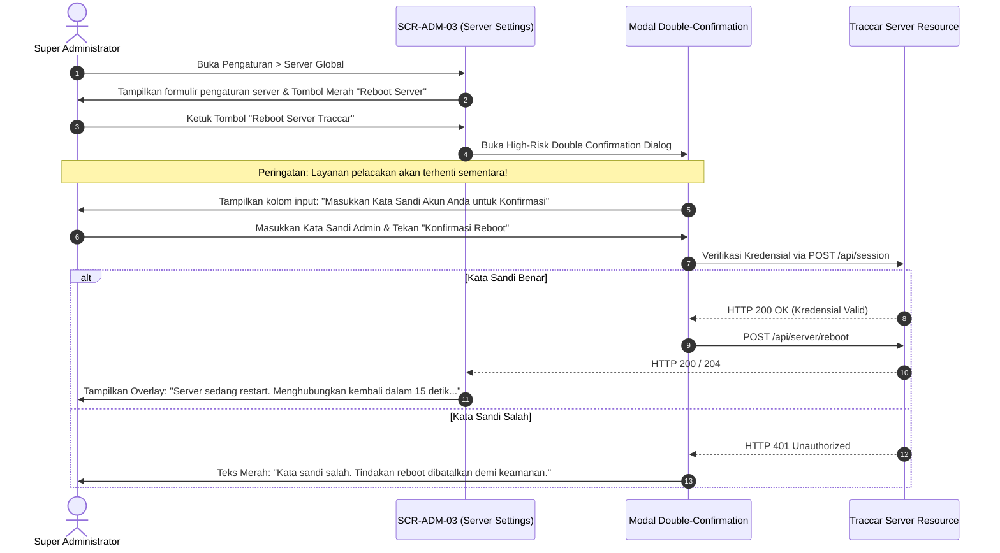

# USER_JOURNEYS.md — Alur Perjalanan Pengguna Lengkap (GPSku)
## Phase 5 Deliverable — UI/UX Redesign & Information Architecture

* **Versi Dokumen:** 1.0.0  
* **Tanggal:** 2026-11-07  
* **Status:** Ready for Review (Phase 5)  
* **Sistem Target:** GPSku — Flutter Multi-Platform (Android, iOS Primary MVP, Web Secondary)  
* **Referensi Sumber:** `docs/01-existing-system/EXISTING_USER_FLOWS.md`, `docs/02-product/PRD.md` v2.1.0, & `docs/03-design/SCREEN_INVENTORY.md`

---

## 1. Daftar 12 Alur Perjalanan Pengguna Utama (Core User Journeys)

Dokumen ini merancang 12 alur kerja pengguna end-to-end yang mengintegrasikan aspek interaksi UI, state management, komunikasi jaringan (REST/WebSocket), dan penanganan error/edge case:

1. **Journey 1:** Login Kredensial Multi-Faktor (Email/Password, TOTP 2FA & SSO)
2. **Journey 2:** Pemantauan Armada Real-time & Navigasi Viewport Peta
3. **Journey 3:** Seleksi Kendaraan & Inspeksi Telemetri Mendalam (*StatusCard*)
4. **Journey 4:** Eksekusi Remote Immobilizer (*Cut-Off Mesin*) dengan *Speed Interlock*
5. **Journey 5:** Pemutaran Jejak Riwayat Perjalanan (*Route Replay Player*) & Ekspor KML
6. **Journey 6:** Pembuatan Batas Wilayah Geofence di Peta & Impor File GPX
7. **Journey 7:** Penarikan Laporan Armada, Filter Periode & Unduh Spreadsheet Excel
8. **Journey 8:** Penerimaan Notifikasi Insiden Real-time & Sirine Audio Darurat
9. **Journey 9:** Sesi *User Impersonation* Administrator & Pembatalan
10. **Journey 10:** Pendaftaran Armada Baru, Upload Foto & Manajemen Grup Cabang
11. **Journey 11:** Administrasi Server Global, Port Protokol & Remote Reboot
12. **Journey 12:** Pembuatan Tautan Pelacakan Publik (*Share Link*) & Tampilan Tamu

---

## 2. Rincian Alur Perjalanan Pengguna

### Journey 1: Login Kredensial Multi-Faktor (Email/Password & TOTP 2FA)

* **Persona:** Seluruh Pengguna
* **Pre-conditions:** Pengguna membuka aplikasi dari kondisi belum login.
* **Edge Cases:**
  * Jaringan terputus saat login: Menampilkan pesan *"Tidak dapat terhubung ke server. Periksa koneksi internet Anda."*
  * Alamat host server salah: Tombol gear di sudut kanan atas memungkinkan pergantian server URL (`SCR-AUTH-04`).

---

### Journey 2: Pemantauan Armada Real-Time & Navigasi Peta

* **Persona:** Dispatcher & Manajer Armada
* **Pre-conditions:** Pengguna telah login dengan token valid.
* **Post-conditions:** Seluruh armada terpantau bergerak mulus di atas layer vektor.

---

### Journey 3: Seleksi Kendaraan & Inspeksi Telemetri Mendalam (*StatusCard*)

1. **Trigger:** Pengguna mengetuk salah satu marker armada di peta (`SCR-MAP-01`) atau mengetuk baris unit di tab daftar armada (`SCR-FLT-01`).
2. **Respon Kamera:** Kamera peta melakukan animasi transisi mulus (*FlyTo*) memusatkan kendaraan target sedikit di atas titik tengah layar agar tidak tertutup sheet.
3. **Penyajian StatusCard (`SCR-MAP-02`):**
   * *Collapsed State (Tinggi 120dp):* Foto unit, plat nomor, status ignition (Mesin Hidup/Mati), kecepatan km/h, dan 3 tombol aksi cepat.
   * *User Gesture (Geser ke Atas):* Mengembang hingga tinggi 50% atau 85% layar.
   * *Data Telemetri Lengkap:* Waktu fix satelit (*fixTime*), total jarak tempuh odometer (km), jam kerja mesin (*engine hours*), voltase aki kendaraan (misal `12.6V`), baterai internal tracker, dan status kartu supir RFID.
   * *Reverse Geocode:* Menampilkan nama jalan dan kota hasil geocoding otomatis.
4. **Tombol Navigasi Eksternal:** Mengetuk tombol navigasi membuka pilihan: Google Maps App, Waze, atau Street View via deep link intent.

---

### Journey 4: Eksekusi Remote Immobilizer (*Cut-Off Mesin*) & Speed Interlock

---

### Journey 5: Pemutaran Jejak Riwayat Perjalanan (*Route Replay Player*)

1. **Trigger:** Pengguna menekan tombol *"Replay"* pada StatusCard unit (`SCR-MAP-02`).
2. **Navigasi Layar:** Masuk ke layar penuh `SCR-REP-01`.
3. **Pemilihan Waktu (`SCR-REP-02`):** Muncul lembar pemilih rentang waktu (Preset: *"Hari Ini"*, *"Kemarin"*, atau *"Kustom"*).
4. **Pengunduhan Koordinat:** Klien mengirimkan `GET /api/positions?deviceId={id}&from={ISO}&to={ISO}`.
5. **Visualisasi Jalur:**
   * Garis polyline rute digambar di atas peta dengan warna segmen gradasi kecepatan: Hijau muda (kecepatan normal), Kuning (sedang), Merah (kecepatan tinggi > batas overspeed).
   * Titik awal ditandai pin bendera hijau (*Start*), titik parkir ditandai ikon *"P"*, dan titik akhir ditandai pin bendera merah (*Finish*).
6. **Interaksi Kontrol Playback:**
   * Pengguna menekan tombol **Play**: Marker mobil virtual bergerak menyusuri garis lintasan dengan sudut rotasi yang presisi menghadap arah perjalanan.
   * Pengguna dapat memilih pengali kecepatan: `1x`, `2x`, `4x`, `8x`, `16x`.
   * Pengguna dapat menggeser *Time Scrubber Slider* maju/mundur untuk melompat seketika ke menit tertentu.
7. **Ekspor KML:** Mengetuk tombol *"Ekspor KML"* mengunduh file `.kml` riwayat ke perangkat dan memicu system share sheet untuk dibuka di Google Earth 3D.

---

### Journey 6: Pembuatan Batas Wilayah Geofence & Impor GPX

---

### Journey 7: Penarikan Laporan Armada & Ekspor Excel

1. **Akses Modul:** Pengguna mengetuk Tab 3 ("Laporan") pada navigasi bawah utama (`SCR-RPT-01`).
2. **Pilihan Jenis Laporan:** Memilih jenis laporan yang diinginkan:
   * *Trips:* Segmen perjalanan (km, durasi, kecepatan max, supir).
   * *Stops:* Titik parkir, lokasi henti, durasi diam.
   * *Summary:* Agregasi total km, jam mesin menyala, dan estimasi konsumsi bahan bakar.
   * *Events:* Riwayat insiden alarm darurat.
   * *Log Titik (Route):* Data mentah seluruh koordinat satelit.
3. **Filter Unit & Tanggal:** Memilih satu kendaraan atau grup cabang, serta memilih periode kalender operasional.
4. **Penyajian Data:** Data disajikan dalam bentuk daftar kartu responsif yang efisien (*virtualized lazy list*).
5. **Ekspor Spreadsheet (.xlsx):**
   * Pengguna mengetuk tombol *"Ekspor Excel"* di sudut kanan atas.
   * Klien mengunduh file biner `.xlsx` dari backend Traccar (`GET /api/positions/xlsx?...`).
   * File disimpan pada direktori dokumen lokal perangkat melalui `path_provider`.
   * Klien memanggil system share sheet (`share_plus`) agar pengguna dapat langsung membuka file di Microsoft Excel atau mengirimkannya ke WhatsApp.

---

### Journey 8: Penerimaan Notifikasi Insiden Real-time & Sirine Darurat

---

### Journey 9: User Impersonation Administrator & Pembatalan

1. **Inisiasi Impersonasi:**
   * Super Administrator atau Manager membuka menu *Pengaturan > Manajemen Pengguna* (`SCR-ADM-01`).
   * Pada baris akun pengguna target (misal: "Budi Rental Unit 2"), Admin mengetuk ikon pintu (*Impersonate*).
2. **Dialog Konfirmasi Keamanan:**
   * Muncul dialog konfirmasi: *"Apakah Anda yakin ingin masuk dan bertindak atas nama Budi Rental? Seluruh aktivitas Anda akan dicatat dalam audit trail."*
   * Admin menekan tombol *"Ya, Lanjutkan"*.
3. **Transisi Sesi Kriptografis:**
   * Klien menyimpan token sesi asli Admin ke secure storage (`admin_original_token`).
   * Klien memanggil `GET /api/session/{userIdBudi}`.
   * Backend mengembalikan profil User Budi dan cookie sesi baru.
4. **Pemasangan Penanda Visual Anti-Tertukar:**
   * Router mengarahkan aplikasi ke Beranda Peta (`SCR-MAP-01`).
   * **Sticky Amber Banner (`#FF9800`)** terpasang permanen di bagian atas layar:  
     `[ 👤 Anda sedang bertindak sebagai: Budi Rental | KEMBALI ]`
   * Garis batas AppBar berubah warna menjadi aksen oranye terang untuk memastikan Admin sadar bahwa ia sedang berada di akun bawahan.
5. **Pengakhiran Sesi Impersonasi:**
   * Admin mengetuk tombol *"KEMBALI"* pada Sticky Banner.
   * Klien memulihkan token sesi asli dari `admin_original_token`.
   * Klien memanggil `GET /api/session?token={admin_original_token}`.
   * Banner oranye dihilangkan, tema AppBar kembali normal, dan data armada Admin asli termuat kembali secara instan.

---

### Journey 10: Pendaftaran Armada Baru, Upload Foto & Grup

1. **Buka Formulir:** Pengguna membuka Tab Armada (`SCR-FLT-01`) dan menekan tombol FAB tambah (`+`).
2. **Pengisian Identitas:** Membuka `SCR-FLT-02`:
   * Nama Armada (misal: *"Avanza Silver B 1234 CD"*).
   * Nomor Unik IMEI Tracker (misal: `868204040123456`). Input ini divalidasi tidak boleh mengandung karakter slash `/` atau `\`.
   * Kategori Ikon: Memilih ikon grafis (Mobil / Motor / Truk / Bus / Pickup).
   * Grup Cabang: Memilih grup induk operasional (misal: *"Cabang Jakarta Selatan"*).
3. **Pengambilan Foto Kendaraan:**
   * Mengetuk avatar foto membuka opsi: *"Ambil dari Kamera"* atau *"Pilih dari Galeri"*.
   * Foto diambil dan dikompresi di sisi klien sebelum dikirim.
4. **Penyimpanan Data:**
   * Menekan tombol *"Simpan Kendaraan"*: Klien mengirimkan `POST /api/devices`.
   * Setelah sukses menerima ID kendaraan, klien mengirimkan foto via `POST /api/devices/{id}/image`.
   * Klien kembali ke daftar armada dengan snackbar hijau *"Kendaraan berhasil didaftarkan"*.

---

### Journey 11: Administrasi Server Global & Remote Reboot dengan Proteksi Sandi

---

### Journey 12: Pembuatan Tautan Pelacakan Publik (*Share Link*) & Tampilan Tamu

1. **Pembuatan Tautan:**
   * Manajer armada membuka StatusCard kendaraan terpilih (`SCR-MAP-02`) dan menekan tombol *"Bagikan Pelacakan"* (`SCR-SPEC-02`).
   * Manajer memilih batas waktu kedaluwarsa link: *"1 Jam"*, *"6 Jam"*, *"24 Jam"*, atau *"7 Hari"*.
   * Klien mengirim `POST /api/share/device` dengan parameter tanggal expiration.
   * Backend mengembalikan URL unik bertoken otorisasi sementara:  
     `https://gpsku.app/share/device/101?token=XYZ789...`
2. **Penyebaran:**
   * Manajer mengetuk tombol *"Salin Tautan"* atau *"Kirim ke WhatsApp"*.
3. **Pengalaman Tamu (Pihak Ketiga / Pelanggan Rental):**
   * Pelanggan rental membuka link tersebut di browser smartphone atau aplikasi GPSku.
   * Klien mengenali rute `/share/` dan menampilkan **Guest Tracking View**: Peta layar penuh yang menampilkan posisi armada secara real-time, kecepatan, dan waktu update terakhir.
   * Antarmuka tamu bersifat *clean & read-only*: Tidak ada navigasi tab bawah, tidak ada menu pengaturan, dan tidak ada tombol immobilizer yang dapat membahayakan keamanan armada.

